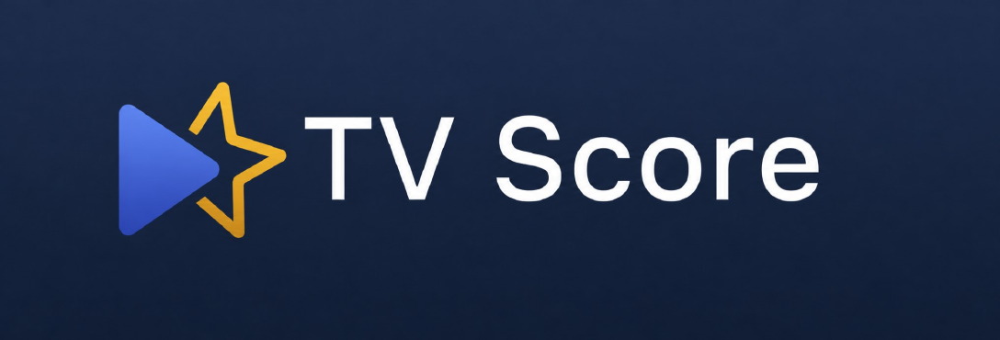
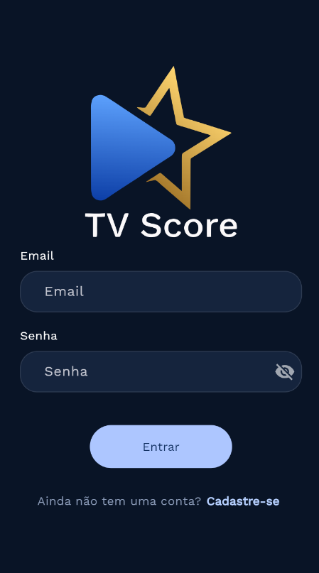
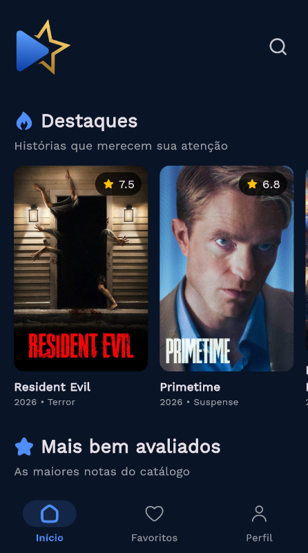
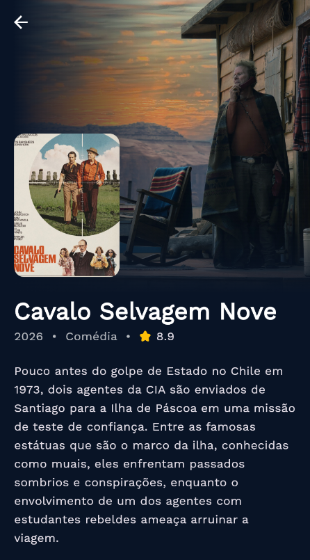

<div align="center">
  

  <h1>TV Score · Landing Page</h1>
  <p><strong>Sua próxima grande história começa aqui.</strong></p>
  <p>Uma apresentação do universo TV Score, das primeiras descobertas às telas do aplicativo.</p>

  
  
  
  

  <br /><br />

  <a href="#sobre-o-projeto">Sobre</a> ·
  <a href="#interface">Interface</a> ·
  <a href="#como-executar">Como executar</a> ·
  <a href="#repositorios-relacionados">Repositórios</a>
</div>

---

<a id="sobre-o-projeto"></a>
## Sobre o projeto

A **landing page do TV Score** apresenta a proposta do aplicativo, seus recursos e sua identidade visual. O visitante pode conhecer a experiência de descoberta de filmes, explorar capturas das telas e consultar a disponibilidade do download.

Desenvolvida com **React e Vite**, a página combina um tema escuro, detalhes em azul e dourado, componentes reutilizáveis e molduras de celulares com profundidade em CSS. A navegação por seções conduz da apresentação inicial à galeria, às perguntas frequentes e à chamada final.

O aplicativo do ecossistema é desenvolvido em **Flutter** e reúne descoberta de filmes e séries, avaliações, favoritos e recomendações. A landing page demonstra essa experiência por meio de textos e capturas de tela.

## Funcionalidades

| Recurso | Experiência |
| --- | --- |
| Apresentação inicial | Introdução ao TV Score e acesso às seções da página. |
| Recursos do aplicativo | Apresentação da descoberta de títulos, consulta de informações e organização de favoritos. |
| Galeria de telas | Capturas de acesso, início e detalhes de um filme, exibidas em molduras de celulares. |
| Molduras 3D | Profundidade, acabamento metálico e perspectiva construídos com CSS. |
| Ampliação | Visualização das telas em uma galeria sobre a página, com fechamento por botão, fundo ou tecla Esc. |
| Como funciona | Apresentação da experiência do aplicativo em três passos. |
| Perguntas frequentes | Respostas organizadas em itens expansíveis. |
| Disponibilidade | Área destinada ao link oficial do aplicativo. |
| Responsividade | Reorganização do conteúdo para diferentes larguras de tela. |

<a id="interface"></a>
## Interface

O azul profundo forma a base da página. Os destaques em azul orientam a navegação, enquanto os detalhes dourados acompanham a marca. As capturas do aplicativo aproximam o visitante da experiência apresentada.

<table>
  <tr>
    <th align="center">Acesso</th>
    <th align="center">Descobertas</th>
    <th align="center">Detalhes</th>
  </tr>
  <tr>
    <td align="center"></td>
    <td align="center"></td>
    <td align="center"></td>
  </tr>
</table>

As imagens acima são capturas do aplicativo utilizadas na apresentação do projeto.

## Tecnologias

| Tecnologia | Aplicação |
| --- | --- |
| React 19 | Componentes, eventos e estado da interface. |
| Vite 7 | Servidor de desenvolvimento e build de produção. |
| JavaScript | Lógica da página e integração das interações. |
| CSS | Layout, responsividade, molduras 3D e transições. |
| Web Animations API | Animações controladas por JavaScript. |
| Intersection Observer | Animação de entrada e saída das seções. |
| HTML semântico | Organização do conteúdo, navegação e controles. |
| Google Fonts | Fontes DM Sans e Manrope. |

<a id="como-executar"></a>
## Como executar

### Pré-requisitos

- Node.js compatível com `^20.19.0` ou `>=22.12.0`, conforme o `package.json`.
- npm instalado com o Node.js.
- Um navegador atualizado.

### Desenvolvimento

Na pasta que contém o `package.json`, instale as dependências e inicie o servidor.

```bash
npm install
npm run dev
```

Abra o endereço exibido pelo Vite no terminal. Ele normalmente utiliza `http://localhost:5173` e escolhe outra porta quando necessário.

### Build e prévia

```bash
npm run build
npm run preview
```

O primeiro comando gera os arquivos de produção em `dist/`. O segundo permite conferir esse resultado localmente.

## Organização do código

```text
public/
└── assets/                 # Logos e capturas do aplicativo

src/
├── components/
│   ├── Header.jsx          # Marca e navegação principal
│   ├── Hero.jsx            # Apresentação inicial
│   ├── Features.jsx        # Recursos do aplicativo
│   ├── Showcase.jsx        # Galeria de celulares
│   ├── PhoneFrame.jsx      # Moldura compartilhada dos dispositivos
│   ├── Gallery.jsx         # Visualização ampliada
│   ├── Steps.jsx           # Etapas da experiência
│   ├── Faq.jsx             # Perguntas frequentes
│   ├── FaqItem.jsx         # Item expansível do FAQ
│   ├── CallToAction.jsx    # Disponibilidade do aplicativo
│   └── Footer.jsx          # Encerramento da página
├── App.jsx                 # Composição das seções e estado da galeria
├── effects.js              # Hooks de efeitos visuais
├── main.jsx                # Inicialização do React
└── styles.css              # Estilos e responsividade

index.html                  # Documento de entrada e metadados
vite.config.js              # Configuração do Vite
package.json                # Dependências e comandos
```

## Personalização

| O que alterar | Onde editar |
| --- | --- |
| Título da página, descrição e favicon | `index.html` |
| Textos e links das seções | Componente correspondente em `src/components/` |
| Cores, espaçamentos e responsividade | `src/styles.css` |
| Estrutura das molduras | `src/components/PhoneFrame.jsx` |
| Visualização ampliada | `src/components/Gallery.jsx` |
| Efeitos das seções e dos cards | `src/effects.js` |
| Imagens e logos | `public/assets/` |

Preserve os caminhos das imagens ou atualize as referências ao substituir arquivos. O nome `logo transparente.png` contém um espaço e deve manter a mesma grafia nas referências.

### Disponibilidade do aplicativo

Enquanto o endereço oficial estiver pendente, a seção `#acesso` informa que o link de download será disponibilizado em breve.

Quando o link estiver definido, atualize `CallToAction.jsx`, os links que direcionam ao download e a resposta correspondente em `Faq.jsx`.

## Validação

Confira o build antes de publicar.

```bash
npm run build
```

Na prévia, verifique a navegação em desktop e celular, a ampliação das telas, o fechamento com Esc, a abertura das perguntas frequentes e os destinos dos links. Confira também a navegação por teclado, a visibilidade do foco e o comportamento das animações com a preferência de movimento reduzido.

## Publicação

Execute o build e publique o conteúdo de `dist/` em uma hospedagem de arquivos estáticos. A configuração do Vite utiliza caminhos relativos para os arquivos gerados.

As fontes externas dependem de acesso ao Google Fonts. As fontes alternativas definidas no CSS são utilizadas quando o carregamento externo está indisponível.

<a id="repositorios-relacionados"></a>
## Repositórios relacionados

O TV Score reúne uma apresentação web e os componentes que sustentam a experiência do aplicativo.

| Componente | Repositório |
| --- | --- |
| Aplicativo Flutter | [victorbispoo/tvScoreFrontFlutter](https://github.com/victorbispoo/tvScoreFrontFlutter) |
| Backend Java | [GuedesSiilva/BackEnd_Projeto_TvScore](https://github.com/GuedesSiilva/BackEnd_Projeto_TvScore) |
| Recomendações em Python | [Kaique-Ramiro/recomendador-TvScore](https://github.com/Kaique-Ramiro/recomendador-TvScore) |

## Créditos

A marca TV Score e as capturas do aplicativo fazem parte dos materiais visuais do projeto. Os pôsteres e as demais imagens de produções exibidas nas capturas pertencem aos respectivos titulares.

O aplicativo utiliza dados e imagens do [TMDB](https://www.themoviedb.org/) e informações de disponibilidade do JustWatch por meio da integração do TMDB. Este produto utiliza a API do TMDB, mas não é endossado nem certificado pelo TMDB.

As fontes são disponibilizadas pelo Google Fonts. Os badges utilizados neste README são fornecidos pelo Shields.io.

---

<p align="center"><strong>TV Score</strong><br />Boas histórias começam com uma descoberta.</p>
